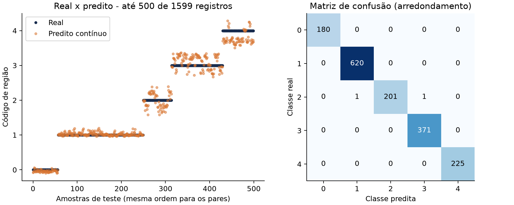
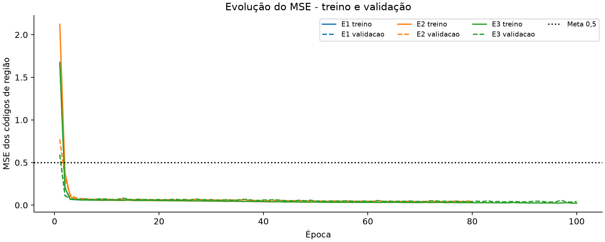
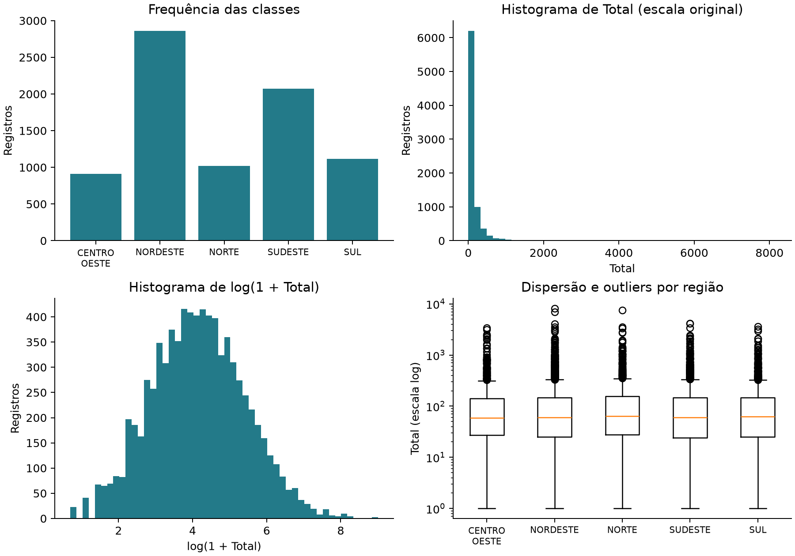

# RNA-MLP · Do dado bruto à avaliação

Um experimento com redes neurais para dados tabulares, cobrindo o caminho completo: tratar a base, separar treino e teste, comparar modelos e interpretar os resultados.


[Notebook com resultados](Projeto_RNA_MLP.ipynb) · [Relatório PDF](output/Relatorio_RNA_MLP.pdf) · [Métricas em CSV](output/metricas_ic95.csv)

## A proposta

O foco deste projeto é construir um experimento reproduzível, com cuidado na preparação dos dados e na avaliação. A MLP recebe nove variáveis e estima um código de região. São comparadas três configurações, usando a validação para escolher o modelo e mantendo o teste reservado até a avaliação final.

A base tem **7.979 registros e 500 municípios fictícios**. Todos os dados são gerados por código, sem consultar fontes externas. Isso permite compartilhar o projeto e reproduzir o experimento sem depender da base usada no exercício que deu origem a ele.



## O que foi cuidado no pipeline

- **Separação por município:** todas as linhas de um grupo ficam na mesma partição. A proporção é 60% dos municípios para treino, 20% para validação e 20% para teste.
- **Pré-processamento sem vazamento:** encoder e normalizador aprendem apenas no treino; categorias inéditas recebem -1.
- **Tratamento dos dados:** ausências, acentos, espaços e contagens com separador de milhar. `2.016` é lido como 2016.
- **Comparação de modelos:** duas larguras de rede, diferentes limites de épocas e early stopping com restauração dos melhores pesos.
- **Avaliação pareada:** cada previsão continua associada à sua observação original. Os intervalos de confiança reamostram municípios inteiros.
- **Modelo exportado e conferido:** os testes recarregam o arquivo `.keras` e comparam suas previsões com as que foram salvas.


## Resultados

Execução em CPU, com semente 101. O experimento **E3** foi selecionado pelo menor MSE de validação.

| Experimento | Camadas ocultas | Limite de épocas | Melhor época | MSE de validação |
| :--- | :--- | ---: | ---: | ---: |
| E1 | 100, 100 | 10 | 7 | 0,065439 |
| E2 | 64, 32 | 80 | 80 | 0,040858 |
| **E3** | **100, 100** | **100** | **99** | **0,035537** |

Todos usam ReLU nas camadas ocultas, saída linear, Adam, learning rate 0,001, batch 64 e paciência de 15 épocas.

| Métrica no teste | Estimativa | Intervalo de 95% |
| :--- | ---: | :--- |
| MSE | **0,030188** | [0,023737; 0,037241] |
| MAE | 0,127541 | [0,107298; 0,148928] |
| R² | 0,981400 | [0,975536; 0,985481] |
| Variância explicada | 0,981402 | [0,975755; 0,985728] |

A referência constante, baseada na média do alvo no treino, obteve MSE **1,626421**. Após arredondar as previsões para classes, a acurácia foi **99,87%**.

Os intervalos usam 1.000 reamostragens dos municípios de teste. Esses números pertencem a um cenário sintético e controlado: a relação entre UF fictícia e região foi definida pelo próprio gerador.



## Como executar

Requisito: **Python 3.12**. Os comandos abaixo usam a convenção de ambiente virtual de macOS/Linux.

```sh
git clone https://github.com/gustdias0/rna-mlp-portfolio.git
cd rna-mlp-portfolio
python3 -m venv .venv
.venv/bin/python -m pip install -r requirements.txt
.venv/bin/python executar.py
```

A execução recria a base em `data/` e os resultados em `output/`, incluindo modelo, previsões, métricas, gráficos e PDF. Os artefatos desta execução já estão no repositório para consulta.

Para usar o notebook, instale as dependências adicionais:

```sh
.venv/bin/python -m pip install -r requirements-notebook.txt
```

Abra `Projeto_RNA_MLP.ipynb` em VS Code ou Jupyter, selecione o interpretador `.venv/bin/python` e execute as células a partir da raiz do projeto.

### Testes

```sh
.venv/bin/python -m unittest -v
```

Oito testes cobrem geração reproduzível, limpeza, validação de contagens, partições sem sobreposição, codificação sem vazamento, treinamento, intervalos, exportações e recarga do modelo.

## Sobre os dados

O gerador usa distribuições e proporções escolhidas para o experimento. Cada município tem de 8 a 24 registros; as classes são desbalanceadas e há ausências sorteadas em três colunas.

| Campo | Papel no experimento |
| :--- | :--- |
| `Regiao` | Alvo com cinco categorias, codificadas de 0 a 4 |
| `Uf` | Dez UFs fictícias, de XA a XJ |
| `Municipio` | Nome no formato `MUNICÍPIO DEMO 0000` |
| `IBGE`, `CNES`, `INE` | Identificadores sintéticos; não são códigos oficiais |
| `Tipounidade`, `Tipoequipe`, `Validacao` | Categorias de demonstração |
| `Total` | Contagem com distribuição assimétrica e cauda longa |

As proporções de municípios por região são 12%, 36%, 12%, 26% e 14%. Ausências são introduzidas com probabilidades de 35% em Tipo Unidade, 10% em INE e 40% em Tipo Equipe. Ausências categóricas viram `AUSENTE`; INE ausente recebe -1. Os outliers são mantidos.



## Limitações e aprendizados

A saída linear sobre códigos de região foi preservada da versão didática. Como região é uma categoria nominal, os códigos não têm ordem ou distância natural: trocar a codificação muda o MSE. Para tratar o problema como classificação, o próximo experimento seria comparar uma saída softmax e métricas por classe.

A relação UF-região foi inserida pelo gerador e também pode ser resolvida por um mapeamento direto. A MLP serve aqui para estudar o pipeline; os resultados não comprovam generalização em dados reais nem justificam seu uso em produção.

O bootstrap mantém fixos o modelo e a divisão dos dados. Os intervalos não incluem a variação entre novos treinamentos. Outros ambientes também podem produzir pequenas diferenças numéricas, mesmo com a semente fixada.

Na combinação de Keras e NumPy utilizada, o salvamento pode emitir um `DeprecationWarning`. A gravação e a recarga foram verificadas; o aviso não é ocultado.

## Organização

```text
├── gerar_dados.py             # Base fictícia reproduzível
├── mlp.py                     # Pré-processamento, treino e avaliação
├── executar.py                # Execução completa
├── Projeto_RNA_MLP.ipynb      # Experimento com saídas salvas
├── test_mlp.py                # Testes do pipeline
├── test_synthetic.py          # Teste do gerador
├── requirements.txt          # Dependências da execução
├── requirements-notebook.txt # Dependências do notebook
├── data/                     # CSV sintético e metadados de origem
└── output/                   # Modelo, métricas, gráficos e relatório
```

Os arquivos `codificacao.json` e `normalizacao.json` registram o pré-processamento aprendido no treino. `particoes.csv` permite conferir a divisão dos registros; `predicoes_teste.csv` guarda os pares real/predito. As versões das bibliotecas ficam em `versoes_ambiente.json`.
